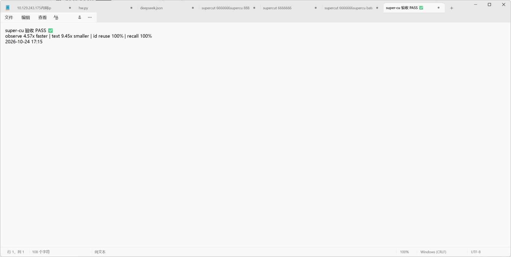
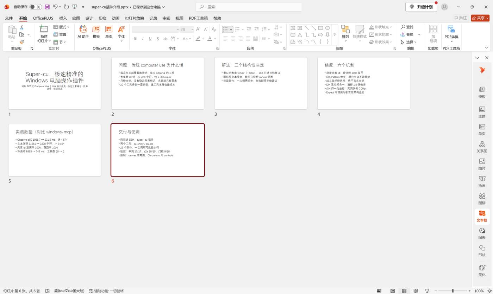
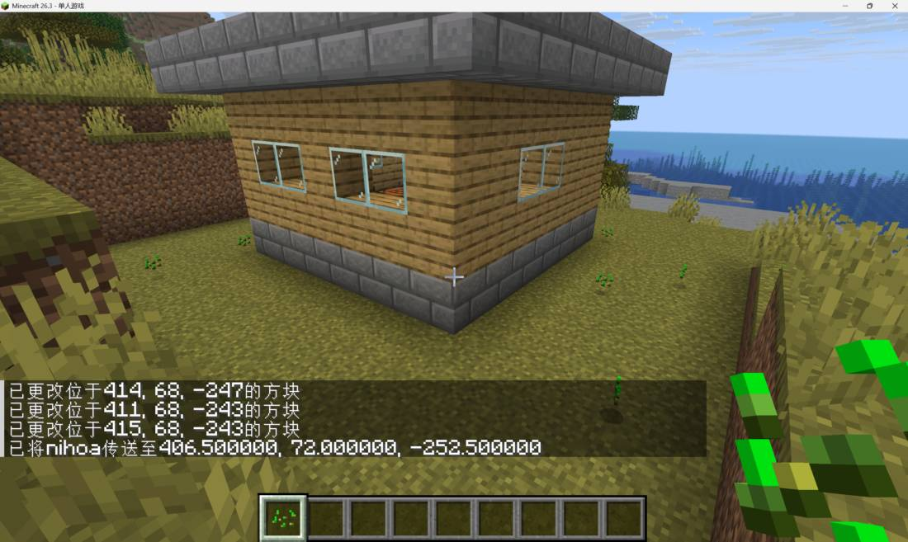

# dsh-super-cu

**Windows 电脑操作插件（DeepSeek Harness / DSH bundle）** — 让智能体**看得懂界面、点得准、还快**。
用 **UI Automation 语义文本**取代截图循环：默认不截图、不猜坐标、一次调用批量做完多步。

> A Windows computer-use bundle for DeepSeek Harness. Two agent tools — `cu_show` (observe) and
> `cu_do` (act) — built on UI Automation with **stable element ids**, **pattern-first actions**,
> **batched steps** and a **visual fallback**. No dependency on screenshots for the normal path.

|  | 实测（同机对比 `windows-mcp` 4.0.3；1.2.0 为成对交织 A/B） |
|---|---|
| 观察延迟 p50（controls，max_nodes=300） | **28 ms**（大 Chromium）/ **92 ms**（Notepad）/ **129 ms**（Explorer） vs 1059 ms → **快 8-38×** |
| 文本体积（Edge 15 标签页） | **3 308 字符** vs 31 261 → **小 9.45×**（~1305 vs ~9472 tokens；1.2.0 与 1.1.2 逐字节相同） |
| 元素级稳定 id | **跨快照 100% 复用**（旧方案只有坐标） |
| 交互元素召回率 | **100%（93/93）** |
| 冷启动到 tools/list | **~256 ms** vs 6 993 ms（1.1.2 是 745 ms，-70.8%） |
| 长会话内存 | **id 表 20000 / 窗口缓存 32** 上限（LRU，id 不复用） |
| 工具数 | **2 个** vs 20 个 |

---

## 为什么快

1. **窗口列表走 win32 `EnumWindows`（~5 ms）**，UIA 只进目标窗口（旧方案每次枚举整桌面 UIA ≈420 ms/次）。
2. **单窗口一次 `BuildUpdatedCache` 取回整棵 raw 子树与属性（1.2.0）**：属性读取在本进程完成，
   大窗口快 8.6×、Notepad 1.7×；任何异常自动回退逐节点 walk，`SUPER_CU_NO_CACHE=1` 可强制回退。
3. **握手后才懒加载/预热重模块（1.2.0）**：`initialize`/`tools/list` 不导入 uiautomation/Pillow，
   冷启动 256 ms；预热用原始线程，不阻塞协议循环。
4. **默认纯文本，不截图**：截图要多一次抓屏+压缩（~90 ms）和上千 token。
5. **有界 DFS 早停**：controls 视图最终只展示前 `max_nodes` 个交互元素，收集满即停；输出逐字节相同、召回 100%。
6. **批量动作**：一次 `cu_do` 完成多步（含等待与断言），把 N 个来回压成 1 个。

## 为什么准

1. **稳定元素 id**：UIA `RuntimeId → 进程内自增 int`，同一元素跨快照 id 不变（实测复用率 100%）；
   失效时按 `(类型, 名字) → AutomationId → 祖先路径` **语义重定位**后继续执行原动作。
2. **Pattern 优先**：`invoke / setvalue / select / toggle / expand / focus` 走 UIA Pattern
   （后台生效、不抢焦点、不动鼠标），不可用才回退真实点击。
3. **歧义即拒绝**：`ct:名字` 命中多个候选时报 `AmbiguousError` 并列出候选，**绝不猜**。
4. **DPI 三空间合一**：启动即 `SetProcessDpiAwarenessContext(PER_MONITOR_AWARE_V2)`，
   使 UIA rect / 抓屏 / 点击落在同一物理像素空间（150% 缩放下旧做法会偏 1.5 倍）。
5. **归一化坐标**：视觉兜底用 `@n:0.42,0.31`（0–1，相对最近截图），换算在服务端完成，模型不做算术。
6. **动作后可断言**：`expect` / `wait` 在同一次调用里确认结果，而不是"做完就走"。
7. **诚实失败**：`disabled` 控件、`pattern_unavailable`、剪贴板被占用、未知按键 —— 都返回
   `ok:false` + 可操作建议，**不静默成功**。

## 工具

### `cu_show` — 观察（默认纯文本，~25–130 ms；1.2.0 缓存快路径）

```
win #39719780 "无标题 - 画图" 2030x1271 @264,159 [focus]
obs 226n/145 shown 239ms controls cut=budget(+61 hidden)
[6] document "开发高效精准的ComputerUse插件"
 [7] button "新建会话" [i]
 [15] edit "搜索会话名称" ~
 [57] tabitem "对话"
```
元素行 = `[稳定 id] 类型 "名字"` + 能力字母（`e` expand > `t` toggle > `s` selection > `v` value > `i` invoke > `c` focusable）+ 状态字符（`*` focus / `+` selected / `-` disabled / `~` offscreen）。
`cut=tree` 表示节点树被截断，`cut=budget(+N hidden)` 表示字符预算裁剪 —— 两者可同时出现。

主要参数：`window`（标题/进程名/`#hwnd`）、`view`（controls/text/all）、`filter`、`max_nodes`、
`screenshot`、`region`、`max_image_width`。

### `cu_do` — 动作（一次调用多步）

```json
{"steps": [
  {"op": "set",  "target": "#8713", "text": "关键词", "expect": "关键词"},
  {"op": "key",  "keys": "enter"},
  {"op": "wait", "text": "搜索结果", "timeout_ms": 3000}
]}
```

- 目标写法：`#id`（推荐） / `ct:名字` / `@n:ux,uy`（视觉） / `@img:x,y` / `@x,y`（物理屏幕）
- 失败即停并给一行 `→` 建议；未执行的步骤跳过
- 目标窗口不在前台会自动 `activate`（含最小化还原、托盘隐藏窗口 `SW_SHOW`）

op 一览：

| 类别 | op |
|---|---|
| 鼠标 | `click` `dblclick` `rightclick` `hover` `drag`（可 `hold_ms`，`to` 支持 `#id` 拖到元素上）`scroll` `scroll_to` |
| 键盘 | `key` `type` `paste` `hold`（按住 N ms） |
| 鼠标按住 | `hold_mouse`（`left/right/middle`，按住期间 100 ms 心跳） |
| UIA | `invoke` `toggle` `select` `expand` `collapse` `focus` `set` |
| 窗口 | `activate` `launch` `close` `minimize` `maximize` `window_move`（`x,y[,w,h]`） |
| 系统 | `clipboard`（`mode: get｜set`） |
| 控制 | `wait`（`wait_kind`: text/element/window/idle/change/gone） `assert` |

### 1.1 新增（全部 opt-in，默认行为不变）

- **`cu_show {"marks": true}`** — Set-of-Mark 截图：给每个可交互元素画编号方框（编号就是 `#id`），
  模型"看得到"也能"点得准"。不加这个参数时返回体与 1.0 **逐字节一致**。
- **`clipboard`** — 读/写剪贴板（写入后回读校验，用完恢复用户原剪贴板）。
- **`window_move`** — 把窗口挪开/改大小（被别的窗口挡住时特别有用），越界自动 clamp。
- **`scroll_to`** — 把元素滚进视口（`ScrollItemPattern` 优先 → 父容器有界滚动 → 明确失败）。
- **`drag.to` 支持 `#id` / `ct:名字`** — 拖到目标元素中心（拖文件进聊天、拖卡片到目标）。
- **`scope=desktop` 同进程提示** — 同一进程的多个窗口标 `[同进程 xN]`（Office 的 SDI 多窗口由此暴露）。
- 依据见 [`docs/RESEARCH.md`](docs/RESEARCH.md)：对比 Windows-MCP / OmniParser / computer-use 规范后，
  采纳了 5 条"不引入视觉模型、不扩权限面"的交互原语，并明确拒绝了 5 条（会拖慢或越权的）。

### 1.2 新增（性能轮，默认行为不变）

- **UIA 缓存请求快路径**：一次 `BuildUpdatedCache` 取回整棵子树，大 Chromium 窗口快 **8.6×**、
  Explorer -39.5%、Notepad -44.5%；任何异常自动回退逐节点 walk（`SUPER_CU_NO_CACHE=1` 强制回退）。
- **冷启动 3.4×**：745 → **~256 ms**（spawn→initialize，-70.8%）；握手后原始线程预热模块，
  `tools/list`→首次 `cu_show` 从 480 ms 降到 **12 ms**（客户端有空闲时）。
- **长会话内存有界**：元素 id 表 20000、窗口缓存 32，LRU 淘汰、id 不复用；
  8 万个不同 id 的合成压测 RSS +12.4 MB（旧版 +45 MB）。
- **cu_do settle**：只有 set/focus 的同步 UIA 中间步骤可在探针确认后提前结束等待；
  真实 5 步 Notepad 批处理 **1230 → 1036 ms**（-15.8%）。
- **修复**：预热线程抢走 `CoInitializeEx` 导致首次真实 `cu_show` 报「尚未调用 CoInitialize」的竞态
  （单元 + 真实进程回归测试）。文本格式、工具 schema、快照契约均未变。
- 细节/证据/复现：`docs/OPTIMIZATION.md`、`docs/OPT-AFTER.md`、`docs/OPT-VERIFY.md`；
  环境开关 `SUPER_CU_NO_CACHE` / `SUPER_CU_NO_PREFETCH` / `SUPER_CU_SETTLE_MIN_MS`。

### 1.4 新增：OpenAI CUA 动作面对齐

OpenAI 2026 版 computer-use driver 的 9 个动作（screenshot / click / double_click / drag / keypress / move /
scroll / type / wait）现在都能通过 `cu_do` 表达，且保留语义层优势：

- `click` 新增 `button`：`left/right/middle(滚轮键)/back/forward`（含 XBUTTON1/2）
- `scroll` 新增 `axis`：`x`（横向滚轮/横向 ScrollPattern）/ `y`
- `drag` 新增 `path`：任意路径点数组（CUA `drag.path`），给 path 时 `to` 可省略
- 指针动作新增 `modifiers`：`ctrl/shift/alt/win` 按住执行（CUA `keys` 等价物）
- 全部可选、默认行为不变；逐动作映射与真机验证见 [docs/CUA-PARITY.md](docs/CUA-PARITY.md)

### 1.3 新增：最小化窗口的后台操作

- **最小化窗口可以直接执行 pattern 动作且不还原窗口**：`invoke / set / toggle / select / expand / collapse`
  在最小化窗口上自动走后台模式，步骤行带 `bg`；也可显式 `background:true`（步骤或整批），单步
  `background:false` 覆盖回前台。
- **输入合成动作仍必须还原窗口**：`click / key / paste / drag / scroll / type` 给 `background:true` 会
  0ms 报错并提示改写，而不是静默抢焦点/还原窗口。
- `cu_show` 窗口行新增 `min` / `max` 标记；最小化窗口的 rect 是图标位置，不能拿来算坐标。
- 应用差异：微信最小化后 UIA 树完整、可后台 `invoke`/`set`（会标 `focus_stolen`，因为微信自己会抢前台）；
  Win11 记事本最小化后内容树不暴露，需要先 `activate`。详见 `docs/MINIMIZED.md`。

## 安装

**要求**：Windows 10/11、Python 3.11+、DSH `>= 0.2`。

```powershell
git clone https://github.com/suntham-t/super-cu.git
cd super-cu
./setup.ps1          # 自动探测 python、安装 Pillow + uiautomation、把绝对路径写进 cordis.patch.yml
```

然后在 DSH 里：**插件 / Plugins → 安装本地插件（install from folder）→ 选这个目录**。
重新开一个会话，工具 `mcp__supercu__cu_show` / `mcp__supercu__cu_do` 就出现了。

> 本插件以 **DSH bundle** 形式分发：`package.json` 声明 `dsh.bundle.patch`，`cordis.patch.yml`
> 通过官方 `@deepseek-ai/dsh-mcp-client` 行拉起一个常驻 Python MCP server（stdio）。
> 目录结构可直接被 `plugin_manager(install_bundle)` 或插件面板安装。

### 插件市场 / Plugin market

本仓库按 [awesome-dsh-plugin](https://github.com/awesome-dsh-plugin/awesome-dsh-plugin) 的收录要求准备：
`package.json` 声明 `dsh.bundle`、根目录有 `cordis.patch.yml`、仓库带 `dsh-plugin` topic。
市场条目位于 [`.market/suntham-t__super-cu.yml`](.market/suntham-t__super-cu.yml)，
用 `./submit-to-market.ps1` 一键投稿（fork → 上传条目 → 开 PR，无需克隆 200MB 索引仓库）。


## 文件

```
package.json           DSH bundle 清单（dsh.bundle.patch）
cordis.patch.yml       MCP client 行（setup.ps1 写入本机路径）
setup.ps1              一次性安装：python 检测 + 依赖 + 路径替换
src/server.py          MCP stdio JSON-RPC、两个工具、坐标/断言/状态
src/bridge.py          UIA 快照 / 稳定 id / 解析 / 动作 / 截图 / wait
src/windows.py         win32 窗口枚举、激活升级链、剪贴板、DPI
src/compact.py         紧凑格式化（去噪 / 折叠 / 预算 / cut 标记）
src/dpi.py             DPI 三空间合一
src/gui_lock.py        多智能体共享桌面的互斥锁
src/mock_bridge.py     离线 mock（协议层测试用）
tests/                 单测 + 真机集成测试（GUI 部分）
bench/opt/             可复现基准（baseline / after / 成对 A/B / fixtures）
bench/verify/          独立验收（parity / golden / 协议 / 性能门禁）
SKILL.md               给智能体的操作手册
docs/CONTRACT.md       完整接口契约（实现细节）
docs/OPT-*.md          1.2.0 优化报告 / 基线 / 对照 / 验收
docs/images/           真实任务截图
```

## 真实验证（不只是单测）

- **基准**：26 个应用/交互场景矩阵（16 PASS / 1 FAIL→已修 / 9 SKIP）、7 组压力与鲁棒性
  （20 步压力 RSS +0.05 MB / 句柄 +0；并发锁 ratio 0.66；`@n` 误差 worst 0.71 px；50 次 id 解析 0 失败）、
  输出质量审计（影子 text 残留 0）。
- **端到端**：记事本输入并保存到磁盘（内容逐字比对）、计算器 7×8=56、PowerPoint 6 页 PPT 并发送到微信
  （无 API 客户端）、微信发消息、画图里画笑脸、Blender 建一棵树、**在真实 Minecraft 里用 `/fill`
  盖了一栋 7×7 带门/窗/屋顶的房子**。
- **回归（1.2.0）**：`tests/test_bridge.py` 真实 55 项（缓存 parity/回退/marks/内存上限/动作）+
  `--unit-only` 24 项；`tests/test_server.py` 197 项 mock 协议测试；独立验收见 `docs/OPT-VERIFY.md`。
- **性能（1.2.0）**：成对交织 A/B 前后对比（冷启动/快照/渲染/截图/端到端/内存）见 `docs/OPT-AFTER.md`；
  基准可复现：`python bench/opt/bench.py --help`。

| | |
|---|---|
|  |  |
|  |  |

## 已知限制

- **无 UIA 的界面**（canvas / 游戏 / 部分自绘 UI）：只能用 `screenshot=true` + `@n` 坐标，慢且依赖视觉。
- **Chromium 的 `view=text`** 取不到正文（TextPattern 为空）→ 用 `controls`（TextControl 的 name 就是文本）。
- **控制台窗口**（conhost）UIA 只有十几个节点、读不到输出文本 → 退路：截图或用非 UI 手段。
- **UIPI**：管理员权限窗口可能拒绝输入/读取。
- **视图切换后的内联状态可能滞后 ~250ms**（应用重绘需要时间）：1.3.1 在改动步骤后先等 150-250ms 再截状态；
  微信等更慢的应用若状态看起来没变，直接再 `cu_show` 一次确认，别重复搜索/点击。
- **标题栏拖动**：目标窗口内部有模态对话框/弹窗时（例如记事本恢复旧标签弹出的「找不到文件」），
  标题栏拖动不会移动窗口（直连 bridge 也一样，属于窗口状态而非插件缺陷）；先处理弹窗再拖。
  正常窗口的标题栏拖动、内容拖动、drag.to=#id 均不受影响。
- **指针锁定 + raw input 的游戏**（如 Minecraft）：`SetCursorPos` 无法转视角；要用游戏内命令或键位。
- **Office 现代「保存此文件」对话框**不接受全路径 → 先「更多选项…」→「浏览」进经典对话框。
- 一次 `cu_do` 建议 ≤10 步（批量期间持有 GUI 锁，其它智能体会等待）。

## License

MIT © 2026 suntham-t

---

### English TL;DR

`dsh-super-cu` is a DeepSeek Harness bundle that gives an agent two tools — `cu_show` (a compact,
token-cheap accessibility snapshot of one window with **stable element ids**) and `cu_do` (a batched
action runner with waits/assertions). Compared with screenshot-based computer use it is **8-38× faster** on snapshots
(28 ms for a large Chromium window) and returns **9.5× less text**; cold start is **~256 ms**.
Element ids are reused across snapshots (100%). Accuracy comes from
UI-Automation patterns, refusing ambiguous targets, DPI-space unification, normalized fallback
coordinates and loud failures. Works on Windows 10/11 with Python 3.11+; install with `setup.ps1`
then add the folder in DSH's plugin manager.
